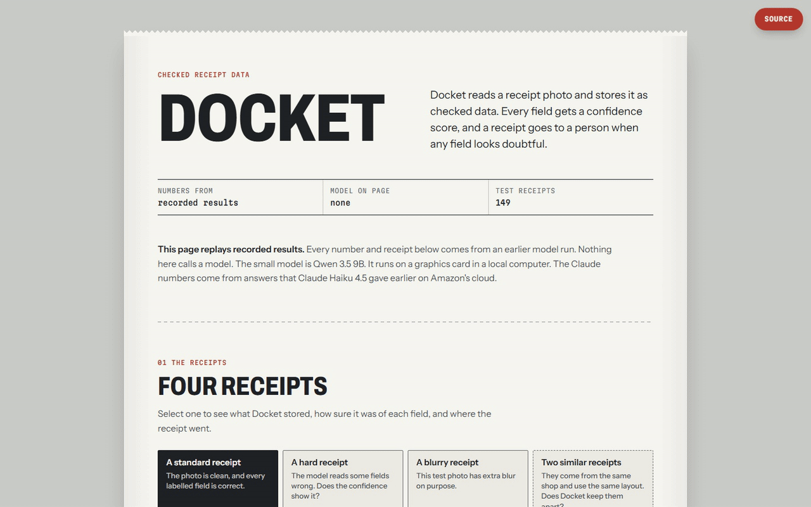
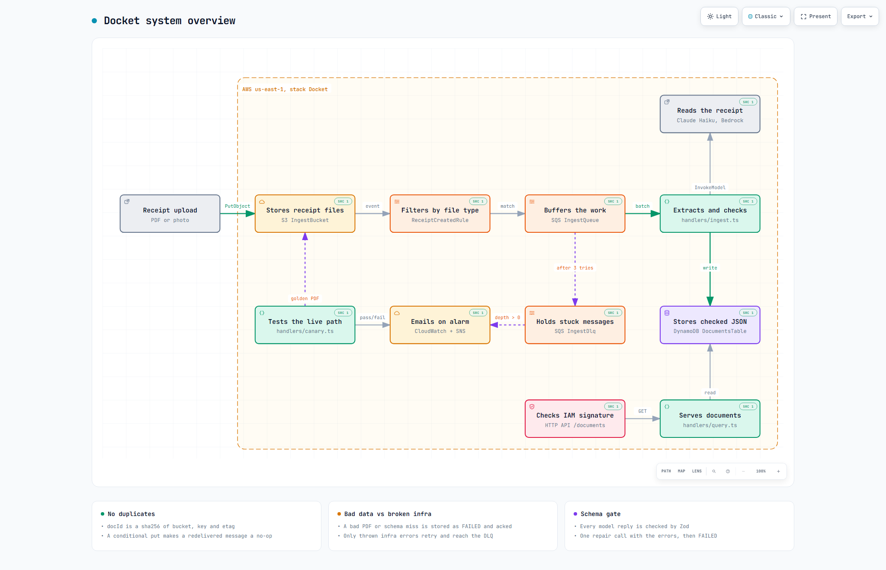
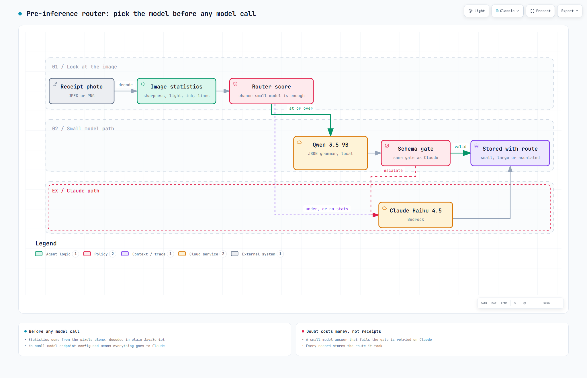
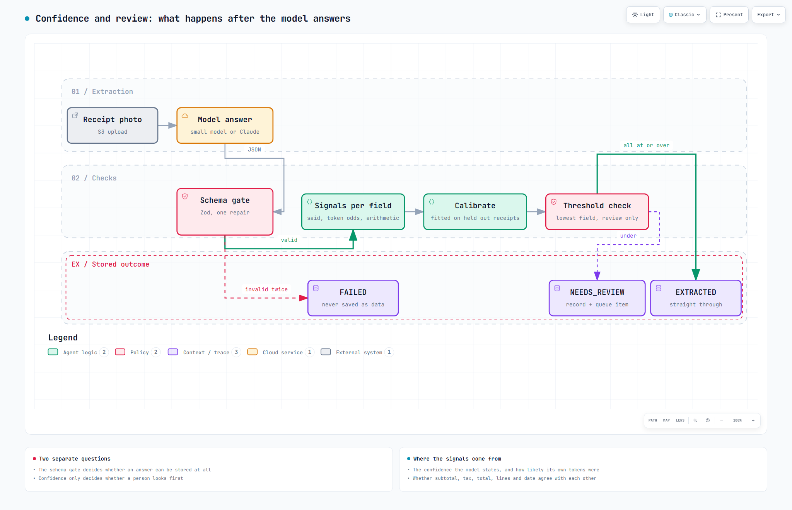
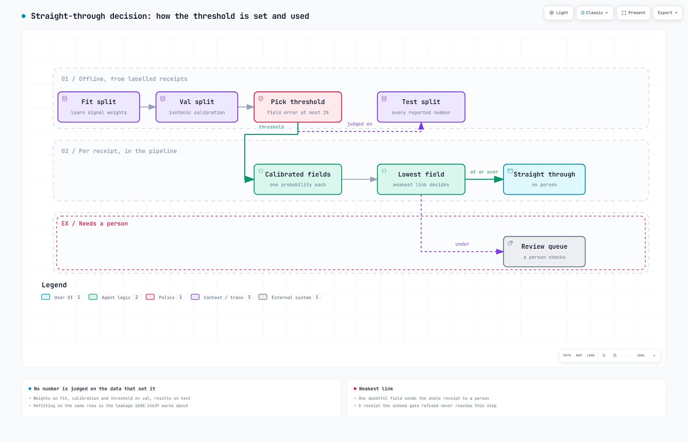

# Docket

Docket reads a photo or PDF of a receipt and turns it into clean, checked data. It does not save an answer that fails a strict format check, because a model can invent a field. A retry never makes a duplicate record. Every field also gets a confidence score. A receipt goes to a person when one of its fields looks doubtful.

**[Open the demo](https://samad-zeeshan.github.io/Docket/)**. It shows recorded results, so it needs no login, no wait and no model. A short recording is in [docs/demo.mp4](docs/demo.mp4).

A 27-second explainer video is in [docs/explainer.mp4](docs/explainer.mp4).



## How it works


When a receipt arrives in S3, EventBridge and SQS pass it to a Lambda function. The Lambda reads the receipt with a model and writes the result to DynamoDB.


Before a model reads the receipt, a photo check picks the small local model or Claude on Bedrock.


The format check decides if Docket can store an answer. Confidence only decides if a person looks first.


Docket sets the threshold on one group of receipts and tests it on another. The least confident field decides. The `docs/diagrams/` folder also shows the upload flow, document states and deployment. Each diagram has an interactive version.

## Data

<!-- results:data -->
| Set | Receipts read | Fields scored | Licence |
| --- | ---: | ---: | ---: |
| SROIE (Malaysia, scans) | 446 | merchant, date, total | CC BY 4.0 per the mirror |
| CORD v2 (Indonesia, photos) | 160 | line items, subtotal, tax, total | CC BY 4.0 |

The small model read 606 of the 1,987 downloaded receipts before its time ran out. The test set holds 149 of these receipts.
<!-- /results -->

The run stopped at a time limit because other jobs share the GPU. The plan set the order of receipts before the run, SROIE and then CORD, so the results did not pick the cut. The run read fewer than the thousand receipts in the plan, which is a gap. SROIE company, date and total map to merchant, date and total. CORD menu lines, subtotal, tax and total map to the same fields.

Docket scores a field only where a set labels it. Neither set labels currency, so Docket does not score currency. `npm run data:fetch` downloads both sets and checks pinned sha256 sums. The repo keeps only ids, splits and image hashes, plus three CORD images for the demo.

## Straight through

<!-- results:stp -->
| Wrong field target | Threshold (tuning) | Straight through (test) | Wrong fields (test) | Model's own confidence | Ladder step held |
| --- | ---: | ---: | ---: | ---: | ---: |
| 1.0% | 0.94 | 7.4% | 0.0% | 0.0% | fit-val split |
| 5.0% | 0.88 | 18.1% | 3.9% | 0.0% | fit-val split |
| 10.0% | 0.61 | 46.3% | 6.5% | 0.0% | fit-val split |

At the tightest target of 1% wrong fields, 11 of 149 test receipts go straight through. That is about 7.4%, which is low. None of their 32 fields is wrong, so this meets the target. The thresholds come from 161 separate tuning receipts. Of the receipts that go straight through, 11 come from SROIE and 0 from CORD.

Docket itself checks all six fields at once. Under that rule, no threshold meets any of the 3 targets. So every receipt from the small model goes to a person. This is safe, but it saves no work yet.
<!-- /results -->

The table checks each receipt only on the fields that Docket calibrated for its set. This assumes that Docket knows the document type, but Docket does not know it yet. With the model's own confidence, no threshold met any target. The fit and tuning step of the validity ladder (arXiv 2608.14639) holds. That step limits the average error but gives no guarantee. The stricter exact binomial steps give no guarantee yet, because the tuning set is small.

<!-- results:calibration -->
| Field | Test fields | Correct | Error, own `ECE` | Error, calibrated | Ranking, own `AUROC` | Ranking, calibrated |
| --- | ---: | ---: | ---: | ---: | ---: | ---: |
| merchant | 111 | 74.8% | 0.217 | 0.177 | 0.606 | 0.771 |
| date | 104 | 93.3% | 0.045 | 0.047 | 0.543 | 0.802 |
| total | 146 | 88.4% | 0.105 | 0.069 | 0.343 | 0.772 |
| subtotal | 37 | 54.0% | 0.440 | 0.060 | 0.338 | 0.612 |
| tax | 37 | 21.6% | 0.611 | 0.127 | 0.830 | 0.914 |
| line items | 36 | 44.4% | 0.477 | 0.216 | 0.613 | 0.564 |
<!-- /results -->

The error columns show the average gap between confidence and how often a field is correct. Lower is better. The ranking columns show how well confidence puts correct fields above wrong ones. A score of 0.5 is a coin toss, and 1 is perfect. Calibration helps most on subtotal and tax, where the model was sure but often wrong. Date does not improve, and line items rank worse after calibration, so line items are the weakest part.

## Model choice and cost

<!-- results:routing -->
| Model and input | Receipts | Right format, first try | After one repair | Fields correct |
| --- | ---: | ---: | ---: | ---: |
| Claude Haiku 4.5, hand checked text | 42 | 100.0% | 100.0% | 0.999 |
| Qwen 3.5 9B held to the format, hand checked text | 42 | 100.0% | 100.0% | 0.984 |
| Qwen 3.5 9B free to answer, hand checked text | 42 | 100.0% | 100.0% | 0.987 |
| Qwen 3.5 9B held to the format, public photos | 20 | 100.0% | 100.0% | 0.909 |
| Qwen 3.5 9B free to answer, public photos | 20 | 85.0% | 85.0% | 0.559 |

When free to answer, the small model failed the format check on 3 of 20 photos, even after one repair. When held to the format, it never failed.

On the test receipts, the small model read every field correctly on about 55% of receipts. The photo check guesses this outcome correctly for about 64% of receipts. A coin toss gets 50%, so the photo check is only a little better. The photo check sends about 44% of receipts to the small model. On those receipts, the small model gets about 10% of fields wrong. On the other receipts, it gets about 36% wrong, so the photo check keeps the hard photos away from it.

If Claude reads every photo, the estimated cost is about $2.3 for each 1,000 receipts. With the photo check, the estimated cost is about $1.3.
<!-- /results -->

The small model is Qwen 3.5 9B on a local GPU. Claude Haiku 4.5 read only the hand checked receipts, and the repo keeps its saved Bedrock answers. Docket had no Bedrock credentials for the public sets. So Claude did not read the public photos, and its cost there is an estimate from the published image token rule. The photo check is only a little better than a coin toss. arXiv 2608.06607 warns about this, because such a check helps only when the small model fails on photos that look bad.

## Damaged photos

<!-- results:robustness -->
The damage test used 4 receipts. With no damage, the small model read 67% of fields correctly. At the worst level of each kind of damage, it read this share of fields correctly:

- Blur: 7.1%
- Tilt: 79%
- Crop: 86%
- Darkness: 79%
- JPEG compression: 64%

Blur does the most harm. With only 4 receipts, all of these figures are rough.

Some receipts look almost the same. Of 371 SROIE pairs from the same shop, 6 pairs are the same file twice. These pairs share an id, which is correct. No two different files share an id, which is good. The small model read both receipts in 85 pairs. No date or total from one receipt went into the other, which is good.
<!-- /results -->

## What this does not show

- Claude's accuracy on the public photos. Every public number comes from the small model.
- Small differences. The test set is small, so a change of a few points can be noise. The damage test is a quick check, not a full curve.
- Production use. The only deployment went to a test account, and that account no longer exists. Docket serves no one. The review queue is a table with no screen.
- Duplicate photos. Docket makes the id from the file, so two photos of one receipt get two ids.

## Design choices

- **Ids come from content.** Each id is a hash of bucket, key and ETag. A conditional write stores it once, so a second delivery or a replay from the dead letter queue never makes a second record.
- **Bad data becomes FAILED.** Only broken infrastructure gets a retry, so the dead letter queue alarm means an outage. Every answer gets one format check with Zod and one repair.
- **Confidence decides review, never correctness.** The confidence step runs after the format check. Docket fits it on one model path, and it applies only to that path. It writes the record and its review queue item in one transaction. Claude gives no token probabilities, so on the Claude path only the arithmetic checks can send a receipt to review.
- **The alarm topic gives CloudWatch the right to publish, in writing.** The TLS rule silently removed the default grant, and then no alarm could send a message. To test an alarm, force it with `aws cloudwatch set-alarm-state` and read its history. Docket removes card numbers, emails and phone numbers before storage. Uploads expire after a month.

## Run it

```bash
npm install && npm test && npm run eval && npm run eval:v2   # tests, the hand checked eval, the drift check
npm run demo                                                  # the demo page on http://localhost:5173
```

## Papers

- arXiv 2609.20110, Perception, Layout, and Validation: calibrated confidence for straight-through processing.
- arXiv 2608.14639, Valid Per-Field Selective Risk Control for Document Extraction: the validity ladder.
- arXiv 2609.26489, Calibration as a First-Class Criterion in LLM Evaluation.
- arXiv 2608.06607, Pre-Inference Routing for Cost-Efficient Document Field Extraction.
- arXiv 2609.23742, Constrained Decoding Eliminates Structural Failures in Small LLMs.
- arXiv 2606.26041, How Robust is OCR-Reasoning? The five kinds of damage.
- arXiv 2606.25343, Invoice Haystack: the near identical receipt test.
- arXiv 2608.22214, Query-Driven Multimodal Information Extraction from Long Documents: future work, for multi-page statements.

## Licence

The code uses the MIT licence, see [LICENSE](LICENSE). SROIE and CORD belong to their authors, and Docket uses them under CC BY 4.0.
